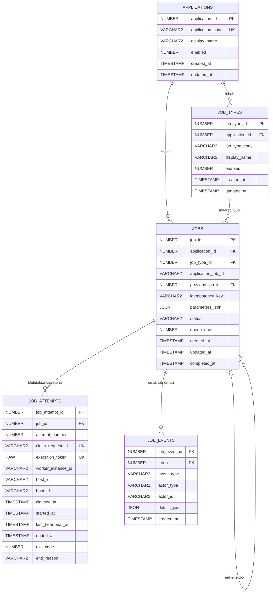

# Oracle'i tööjärjekorra andmemudel

## 1. Dokumendi päritolu

Koostaja: AI (OpenAI Codex) kasutaja juhiste, [`docs/lahteylesanne.md`](../docs/lahteylesanne.md) ja [`docs/tehniline_spek_ords.md`](../docs/tehniline_spek_ords.md) põhjal. Kasutaja vaatas olemid ja veerud arutelu käigus ükshaaval üle.

Dokument kirjeldab MVP1 füüsilist Oracle'i andmemudelit. Teostav DDL asub failis [`schema/001_core_schema.sql`](schema/001_core_schema.sql).

## 2. Sisukord

- [3. ERD](#3-erd)
- [4. Tabelite ja veergude kommentaarid](#4-tabelite-ja-veergude-kommentaarid)
- [5. Terviklusreeglid](#5-terviklusreeglid)

## 3. ERD

## 4. Tabelite ja veergude kommentaarid

### 4.1. `APPLICATIONS`

Keskse järjekorraga liidestatud rakenduste register.

| Veerg | Kommentaar |
|---|---|
| `application_id` | Rakenduse sequence'ist automaatselt saadav primaarvõti. |
| `application_code` | Rakenduse püsiv masinloetav tunnus, mille rakendus saadab ORDS-i päringutes. |
| `display_name` | Rakenduse inimesele kuvatav nimi. |
| `enabled` | `1` lubab rakendusel töid esitada ja claim'ida; `0` keelab selle. |
| `created_at` | Rakenduse kirje loomise aeg UTC-s. |
| `updated_at` | Rakenduse kirje viimase muutmise aeg UTC-s. |

### 4.2. `JOB_TYPES`

Rakendustele registreeritud tööliigid, millele vastab rakenduse workeris lubatud adapter.

| Veerg | Kommentaar |
|---|---|
| `job_type_id` | Tööliigi sequence'ist automaatselt saadav primaarvõti. |
| `application_id` | Rakendus, millele tööliik kuulub. |
| `job_type_code` | Püsiv masinloetav tööliigi tunnus, mis valib rakenduse workeris adapteri. |
| `display_name` | Tööliigi inimesele kuvatav nimi. |
| `enabled` | `1` lubab seda liiki uusi töid esitada ja käivitada; `0` keelab selle. |
| `created_at` | Tööliigi kirje loomise aeg UTC-s. |
| `updated_at` | Tööliigi kirje viimase muutmise aeg UTC-s. |

### 4.3. `JOBS`

Rakendusteülene autoriteetne tööjärjekord ja töö hetkeseis.

| Veerg | Kommentaar |
|---|---|
| `job_id` | Töö sequence'ist automaatselt saadav primaarvõti ja ORDS API keskne töö tunnus. |
| `application_id` | Rakendus, millele töö kuulub. |
| `job_type_id` | Registreeritud tööliik, mis määrab rakenduse workeris kasutatava adapteri. |
| `application_job_id` | Kohustuslik tunnus, mis seob keskse töö rakenduse enda protsessi või tegevusega; see ei ole kohaliku järjekorra tunnus. |
| `previous_job_id` | Sama rakenduse eelmine töö, mis peab enne selle töö käivitamist olema olekus `SUCCEEDED`. |
| `idempotency_key` | Rakenduse antud korduskindluse tunnus; sama rakenduse sama võti ei loo uut tööd. |
| `parameters_json` | Tööliigi lepingu järgi valideeritud käivitusparameetrid JSON-vormingus. |
| `status` | Töö keskne olek. |
| `queue_order` | FIFO sorteerimisvõti; algväärtus tuleb sequence'ist sammuga `100`. |
| `created_at` | Töö loomise aeg UTC-s. |
| `updated_at` | Töö viimase muutmise aeg UTC-s. |
| `completed_at` | Töö lõppolekusse jõudmise aeg UTC-s. |

### 4.4. `JOB_ATTEMPTS`

Töö reserveerimise ja käivitamise katsed koos workeri, hosti ning täitmise oleku andmetega.

| Veerg | Kommentaar |
|---|---|
| `job_attempt_id` | Täitmiskatse sequence'ist automaatselt saadav primaarvõti. |
| `job_id` | Töö, mida selle katsega käivitati. |
| `attempt_number` | Katse järjekorranumber sama töö piires, alates ühest. |
| `claim_request_id` | Workeri antud globaalselt unikaalne korduskindel claim-päringu tunnus. |
| `execution_token` | Oracle'i `SYS_GUID()` abil loodud unikaalne token käivitamise, heartbeat'i ja lõpetamise kinnitamiseks. |
| `worker_instance_id` | Konkreetse workeri käivituse tunnus. |
| `host_id` | Ubuntu hosti püsiv tunnus. |
| `boot_id` | Ubuntu konkreetse buudi tunnus failist `/proc/sys/kernel/random/boot_id`. |
| `claimed_at` | Aeg UTC-s, mil Oracle reserveeris töö workerile. |
| `started_at` | Aeg UTC-s, mil worker kinnitas tegeliku protsessi käivitumise. |
| `last_heartbeat_at` | Viimase eduka heartbeat'i aeg UTC-s. |
| `ended_at` | Täitmiskatse lõpetamise aeg UTC-s. |
| `exit_code` | Rakenduse adapteri teatatud protsessi väljumiskood, kui see on olemas. |
| `end_reason` | Masinloetav põhjus, miks täitmiskatse lõppes. |

### 4.5. `JOB_EVENTS`

Töö oleku- ja haldustoimingute ajalooline sündmuslogi.

| Veerg | Kommentaar |
|---|---|
| `job_event_id` | Sündmuse sequence'ist automaatselt saadav primaarvõti. |
| `job_id` | Töö, millega sündmus on seotud. |
| `event_type` | Masinloetav sündmuse liik. |
| `actor_type` | Sündmuse põhjustanud osapoole liik: `APPLICATION`, `WORKER`, `USER` või `SYSTEM`. |
| `actor_id` | Sündmuse põhjustanud konkreetse osapoole tunnus. |
| `details_json` | Sündmuseliigipõhised struktureeritud lisaandmed ilma saladusteta. |
| `created_at` | Sündmuse toimumise aeg UTC-s. |

## 5. Terviklusreeglid

- Primaarvõtmed saavad väärtuse tabelipõhise sequence'i `NEXTVAL` vaikeväärtusest.
- `queue_order` algväärtus tuleb sequence'ist sammuga `100`; järjekorra käsitsi muutmisel võib kasutada naaberväärtuste keskmist.
- `queue_order` unikaalsus kehtib ainult olekus `QUEUED` töödele, mistõttu ajalooliste tööde väärtusi ei pea ümber nummerdama.
- Tööliigi kood on unikaalne ühe rakenduse piires.
- Idempotentsusvõti on unikaalne ühe rakenduse piires.
- `previous_job_id` võib viidata ainult sama rakenduse tööle ega tohi viidata samale tööle.
- Korraga võib olla ainult üks töö olekus `CLAIMED`, `RUNNING` või `UNKNOWN`; seda jõustab funktsioonipõhine unikaalne indeks.
- Sõltuv töö on käivitatav ainult siis, kui eelmine töö on olekus `SUCCEEDED`; mittekäivitatavast tööst minnakse järgmise käivitatava töö otsimisel mööda.
- Claim-päringu tunnus ja täitmise token on globaalselt unikaalsed.
- Runtime'is ei kustutata töid, täitmiskatseid ega sündmusi füüsiliselt ning välisvõtmetel pole `ON DELETE CASCADE` reegleid.
